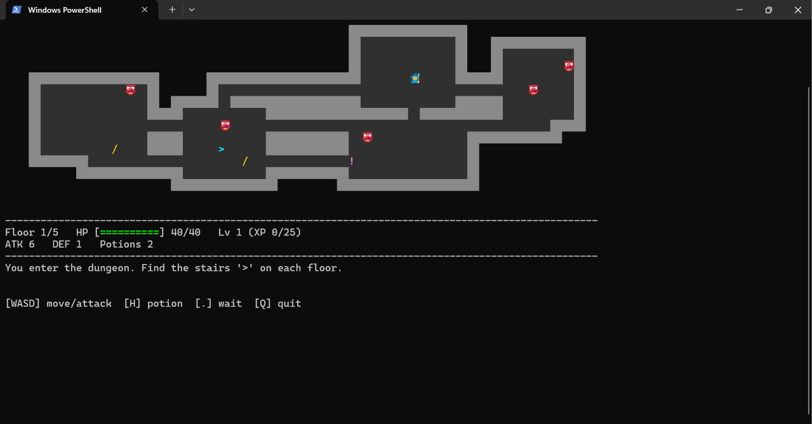

# Dungeon Roguelike (C++)

A top-down 2D roguelike that runs in the terminal. Explore randomly generated dungeon floors, fight enemies, collect upgrades, and defeat the Dragon on floor 5.



## Features

- **Randomly generated floors:** rooms and corridors are different every run
- **5 floors** with stairs (`>`) leading down, ending in a **Dragon boss fight**
- **Enemy types** with different behavior:
  - Goblin: weak and fast
  - Skeleton: hits harder
  - Orc: strong but moves only every other turn
  - Dragon: ranged fire breath every third turn
- **Enemy AI:** enemies chase you when you're close and wander when you're not
- **Items:** health potions, sword upgrades, armor upgrades
- **XP and leveling:** each level restores your HP and boosts your stats
- **Critical hits:** 10% chance to deal double damage
- **Colored terminal display** with emoji sprites (can be switched off)

## Getting Started

### Requirements

- A C++ compiler with C++14 support (for example GCC / MinGW)
- A terminal that supports ANSI colors (Windows Terminal, PowerShell on Windows 10+, or any Linux/macOS terminal)

### Build and run

```bash
g++ -std=gnu++14 -o roguelike roguelike.cpp
```

Windows (PowerShell):
```powershell
.\roguelike.exe
```

Linux / macOS:
```bash
./roguelike
```

## Controls

| Key | Action |
|---|---|
| `W` `A` `S` `D` or arrow keys | Move (walk into an enemy to attack) |
| `H` | Drink a potion (+30 HP) |
| `.` | Wait a turn |
| `Q` | Quit |

## How to Play

1. Find the stairs `>` on each floor and walk onto them to descend (you heal 10 HP).
2. Pick up items by walking over them: potions `!`, sword upgrades `/`, armor `[`.
3. Defeat enemies to gain XP and level up.
4. On floor 5, defeat the Dragon to win.

Tips: fight in corridors so only one enemy can reach you at a time, and save potions for the Dragon.

## Settings

Near the top of `roguelike.cpp`:

| Constant | Meaning |
|---|---|
| `USE_EMOJI` | `true` for emoji sprites, `false` for plain letters (use this if your terminal can't display emoji) |
| `MAP_W`, `MAP_H` | Map size in tiles |
| `MAX_FLOOR` | Number of floors |

## Project Structure

```
.
├── roguelike.cpp   # 2D terminal roguelike
├── dungeon.cpp     # text-based dungeon crawler (earlier version)
└── README.md
```

## C++ Concepts Used

- **OOP:** inheritance, polymorphism, abstract classes, virtual functions
  - `Entity` → `Player` / `Enemy` → `Goblin`, `Skeleton`, `Orc`, `Dragon`
  - Each enemy overrides behavior (`act()`, `canMoveThisTurn()`, `verb()`)
  - `Item` is an abstract base class with `HealthPotion`, `SwordUpgrade`, and `ShieldUpgrade`
- **Smart pointers:** `std::unique_ptr` for enemies and items
- **STL:** `vector`, `deque`, `pair`, `string`, and `<algorithm>` (`remove_if`, `min`, `max`)
- **Procedural generation:** random room placement with overlap checks and corridor carving
- **Game loop:** input, update, and render, with a flicker-free redraw using ANSI escape codes
- **Cross-platform input:** `conio.h` on Windows, `termios` on Linux/macOS


```bash
g++ -std=gnu++14 -o dungeon dungeon.cpp
```

Type `help` in the game to see all commands.

## Possible Future Improvements

- [ ] More enemy types with unique abilities
- [ ] Gold and a shop
- [ ] Keys and locked doors
- [ ] Save and load for the roguelike
- [ ] High score table saved to a file
- [ ] Graphical version using SFML

## Development Notes

This project was built to practice C++ object-oriented programming (OOP) and the Standard Template Library (STL). While the base code and certain components were generated with AI assistance, I handled the subsequent development and thoroughly tested the entire codebase.
In future I will add more game features to it. Till then enjoy the game and tell me what more can I add in the game.


## License

MIT License. Feel free to use and learn from this code.
